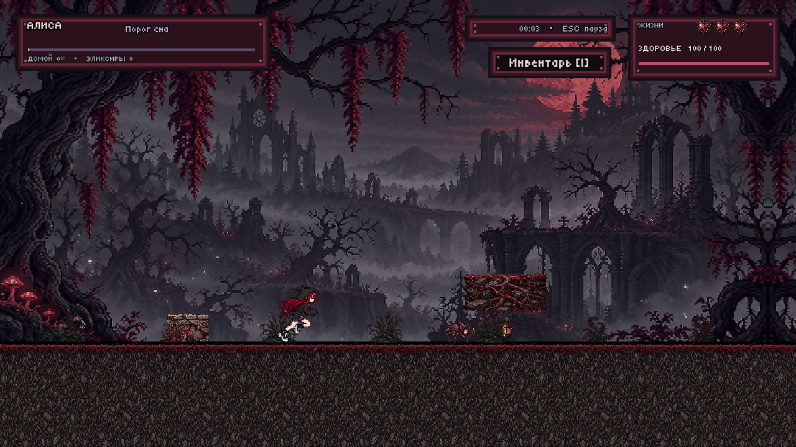

# Алиса в Шизолесье

**Готический пиксельный платформер о путешествии по собственному сну.** Алиса идёт через лес, замок и подземелье к дереву-дому, чтобы проснуться.

[🎮 Играть в браузере](https://alice-in-schizoforest.vercel.app/) · [⬇️ Скачать Windows ZIP](https://github.com/neonkitts/Alice-in-Schizoforest/releases/download/v1.7.4/AliceInSchizoforest-Windows.zip) · [📂 Исходники Unity](Assets) · [📖 Игровой дизайн](docs/GAME_DESIGN_RU.md)

## Идея

Отправной точкой для «Алисы в Шизолесье» стали эстетика и личные образы одного человека. Три главных противника выбраны осознанно: каждый превращает знакомое переживание в игровую встречу, а способ столкновения с ним раскрывает смысл образа.

- **Демон тревожности** возникает на пути неожиданно для игрока. Тревога тоже редко предупреждает о своём появлении.
- **Демон качалки** преследует Алису: он воплощает навязчивую мысль о том, что пора идти в зал, и привычку откладывать этот шаг, которые могут возвращаться снова и снова.
- **Демон заживления татуировки** ждёт в подземелье, а не гонится за героиней по локации. Заживление нельзя обойти, если решение сделать татуировку уже принято: с ним придётся встретиться и пройти через него.

## Игровой цикл

**Фантазия игрока:** пройти тревожный сон, не потеряв нить пути, и вывести Алису домой. Мрачный лес постепенно раскрывается через короткие встречи, рискованные участки и награды.

1. Продвигайтесь по процедурно собранной тропе, читая рельеф и выбирая момент для прыжка или приседа.
2. Сражайтесь с жучками и демонами, следите за здоровьем, собирайте эликсиры и используйте контрольные точки.
3. Встречайте персонажей и находите предметы: диалог с Чумным доктором усиливает следующий удар, спасение котёнка РА открывает спутника и дополнительную жизнь.
4. Пройдите погоню в замке и бой в подземелье, затем доберитесь до дерева-дома.

Каждый новый сон меняет карту. Между основными событиями в новых играх заложено около минуты непрерывного бега; препятствия и встречи увеличивают фактическое время. Основной маршрут задуман примерно на 15 минут.

## Особенности

- **Два пика напряжения:** десятисекундная погоня Демона качалки и отдельный бой с монстром подземелья.
- **Ресурсы с понятной ценой:** три жизни, 100 здоровья, лечебные эликсиры, контрольные точки и одноразовые предметы.
- **Личные встречи:** Чумной доктор, котёнок РА и финал у дерева-дома связывают механики с историей.
- **Цельный стиль:** угольная, серая и бордовая палитра, резные готические панели, пиксельная графика и отдельные музыкальные темы.

[Подробный разбор игровых систем и структуры прохождения](docs/GAME_DESIGN_RU.md). [История разработки и полный список изменений](docs/DEVELOPMENT_RU.md).

## Продолжение — «Кусочек океана»

Вторая часть продолжает историю в мире, созданном под влиянием творчества исполнителя. Сквозной сюжет о богине гроз ведёт игрока к двум другим богам и столкновениям с ними. Переход в другое измерение меняет ход путешествия; вместе с ним в игре используются и другие механики, раскрывающие этот мир. Финальная кат-сцена завершает линию богини гроз, которая проходит через всю игру.

«Кусочек океана» ещё находится в доработке.

## Управление

| Действие | Клавиши |
| --- | --- |
| Движение | A/D или стрелки |
| Прыжок / присед | W / S |
| Атака | Пробел или J |
| Инвентарь | I |
| Спасти котёнка рядом с Алисой | E |
| Пауза / звук | Esc / M |

На сенсорных устройствах доступны экранные кнопки. Обучение из пяти этапов можно пропустить.

## Запуск и исходники

- **Браузер:** откройте [игру](https://alice-in-schizoforest.vercel.app/). Сохранение браузерной версии хранится локально.
- **Windows:** скачайте [архив релиза](https://github.com/neonkitts/Alice-in-Schizoforest/releases/tag/v1.7.4), распакуйте его целиком и запустите `Alice.exe`.
- **Unity:** откройте корень репозитория через Unity Hub в Unity **6000.4.7f1**. Основной проект находится в `Assets`, `Packages` и `ProjectSettings`. Папки `Library` и готовые сборки в Git не включены.

**Статус:** игра ещё дорабатывается. Текущая версия — 1.7.4. Windows-сборка и WebGL проверялись автоматическими сценариями; результаты и ограничения описаны в [QA](QA/RELEASE_1.7.4.md). Публикация в Яндекс Играх и модерация пока не выполнены.

## Авторство

Концепция, история и требования — автор проекта. Реализация и техническая адаптация выполнены с помощью Codex. Изображения созданы с помощью imagegen; сведения о промптах и музыкальных ресурсах находятся в [заметках разработки](docs/DEVELOPMENT_RU.md).
